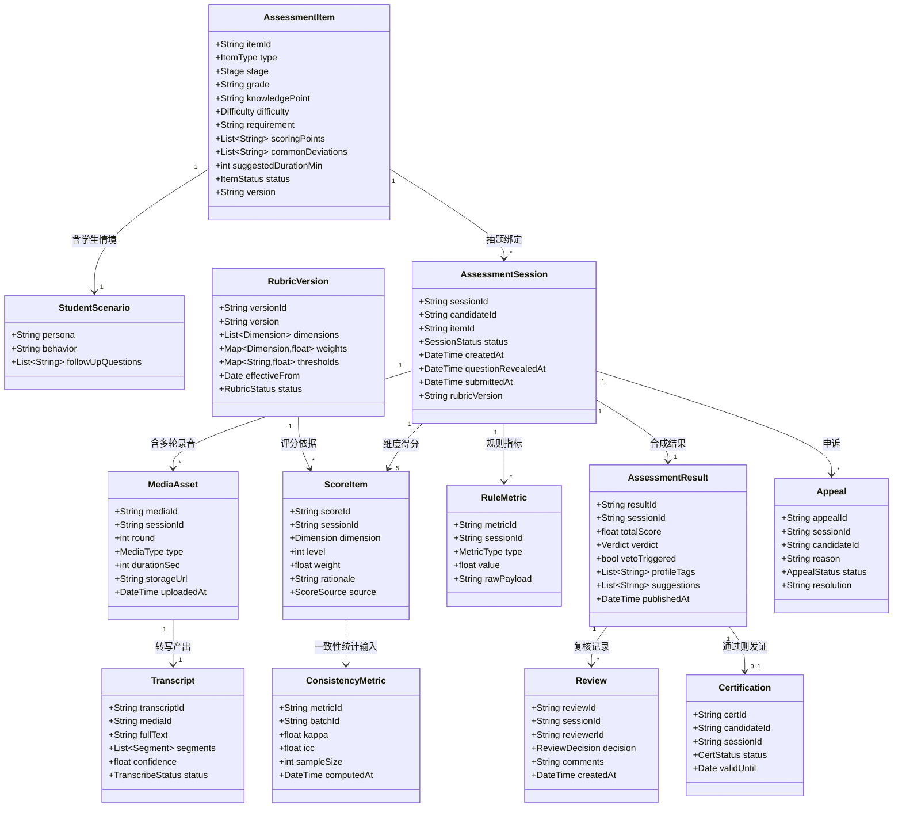
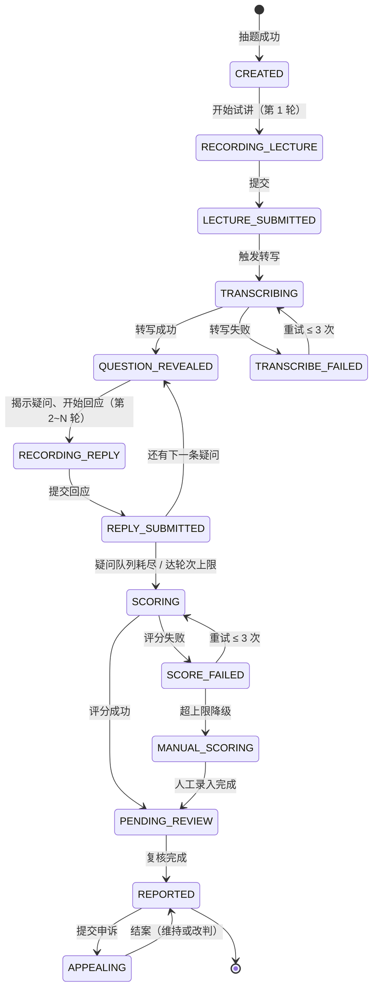

# 软件系统功能规格说明书

> 项目：教学能力评估智能体（约师）
> 版本：v1.0 ｜ 文档类型：需求阶段 — 功能需求规范
> 配套文档：[problem_definition.md](problem_definition.md) · [nonfunctional_spec.md](nonfunctional_spec.md) · [README.md](../../README.md)

---

## 0. 范围与边界

### 0.1 本系统是什么

本系统是**教学能力评估智能体**：通过「情景模拟试讲 + AI 评分」，对面向初中数学的大学生家教进行教学能力评估，输出能力报告与认证结论。

### 0.2 本规格覆盖范围（In Scope）

- 题目（题库）管理与抽题（题目中的"学生情境"由情景卡承载）
- 评估会话编排（异步多轮：讲题 → 多轮文本疑问回应）
- 录制采集、语音转写
- AI 评分（rubric 分维度打分）+ 规则指标计算
- 人工复核、申诉
- 能力报告与认证结果输出

### 0.3 明确排除范围（Out of Scope）

| 排除项 | 说明 |
|---|---|
| **学科知识准入测试** | 前置的知识测试模块**不属于本系统**，不做、不设计、不接口 |
| 其他学段与学科 | 小学 / 高中、语文 / 英语等，本版仅初中数学 |
| 实时语音交互 | 不含实时语音 AI 虚拟学生、打断处理、TTS |
| 视频多模态分析 | 不含表情 / 眼神 / 板书分析 |
| 家教平台业务功能 | 订单、支付、IM、老师主页展示、搜索推荐算法本身 |
| 教学培训与提升 | 本系统只做"测量"，不做"培训" |
| 实名 / 学籍认证 | 由外部系统提供，本系统仅消费认证结论 |

> **边界说明**：本系统只负责"评"，不负责"教"，也不负责"准入门槛的前置筛选"。下游推荐系统如何消费评估结果，由下游系统自行定义。

---

## 1. 系统角色 (Actor)

| 编号 | 角色 | 类型 | 职责 |
|---|---|---|---|
| **AC-1** | **试讲者**（大学生） | 人 | 发起评估、录制多轮试讲、查看报告、提交申诉 |
| **AC-2** | **复核员** | 人 | 人工复核 AI 评分、改判、处理申诉 |
| **AC-3** | **评估管理员** | 人 | 管理题目题库、配置 rubric 与阈值、制定抽检策略 |
| **AC-4** | **评分引擎** | 系统 | 异步执行转写、规则指标计算、LLM 评分、结果合成 |
| **AC-5** | **下游消费系统** | 系统 | 查询并消费评估结论与认证标识（如推荐系统） |

---

## 2. 功能树 (Feature Tree)

### FR-1 题目与题库管理

- **FR-1.1** 题目增删改查（含"学生情境"由情景卡承载）
- **FR-1.2** 题目字段完整性校验（必填项、评分要点、常见偏差）
- **FR-1.3** 题库批量导入 / 导出（CSV / JSON）
- **FR-1.4** 抽题：按题型 / 环节 / 难度加权随机
- **FR-1.5** 防泄题：轮换、限次、一题一用
- **FR-1.6** 题目启停用与版本管理

### FR-2 评估会话编排

- **FR-2.1** 发起评估会话（绑定试讲者与题目）
- **FR-2.2** 会话状态机流转与非法流转拦截
- **FR-2.3** 备课计时与多轮录制限时
- **FR-2.4** 疑问后置揭示（首条疑问在试讲提交后揭示，后续疑问逐轮揭示）
- **FR-2.5** 中断恢复与会话超时处理
- **FR-2.6** 评估次数与冷却期控制（未通过 7 天后可重考）
- **FR-2.7** 答辩环节多轮编排：逐轮揭示疑问 → 录制回应 → 队列耗尽或达轮次上限后进入评分

### FR-3 录制与采集

- **FR-3.1** 浏览器内录音 / 录像
- **FR-3.2** 分片上传与断点续传
- **FR-3.3** 媒体格式与时长校验
- **FR-3.4** 本地草稿保存与恢复
- **FR-3.5** 转码与音频标准化

### FR-4 语音转写

- **FR-4.1** 调用 ASR 生成全文转写
- **FR-4.2** 生成词级 / 句级时间戳
- **FR-4.3** 转写失败重试与降级
- **FR-4.4** 转写结果人工校订

### FR-5 评分

- **FR-5.1** LLM 按 rubric 分维度打分
- **FR-5.2** 每个维度输出文字理由
- **FR-5.3** 规则指标计算（语速、时长、口头禅频率）
- **FR-5.4** 一票否决判定
- **FR-5.5** 总分合成与准入判定
- **FR-5.6** 评分失败重试与降级人工
- **FR-5.7** 评分结果版本追溯

### FR-6 人工复核

- **FR-6.1** 待复核队列
- **FR-6.2** 复核工作台（音视频 + 转写 + AI 分对照）
- **FR-6.3** 维度改判与理由留痕
- **FR-6.4** 抽检策略配置
- **FR-6.5** 复核争议仲裁

### FR-7 报告与认证输出

- **FR-7.1** 能力报告生成（总分 / 雷达图 / 标签 / 建议）
- **FR-7.2** 试讲片段回放
- **FR-7.3** 认证标识生成与有效期管理
- **FR-7.4** 下游系统查询接口

### FR-8 申诉

- **FR-8.1** 申诉提交（结果发布后 7 天内）
- **FR-8.2** 申诉受理与重新复核
- **FR-8.3** 改判与报告重发
- **FR-8.4** 申诉结果通知

### FR-9 Rubric 与阈值配置

- **FR-9.1** Rubric 维度与分档描述配置
- **FR-9.2** 权重与准入阈值配置
- **FR-9.3** 版本管理与生效时间
- **FR-9.4** 配置变更回归验证

### FR-10 数据与质量分析

- **FR-10.1** 标注数据集沉淀（AI 分 vs 人工分）
- **FR-10.2** 一致性指标计算（Kappa / ICC）
- **FR-10.3** 分维度分布与区分度统计
- **FR-10.4** 操作审计日志

---

## 3. 领域模型 (Domain Model UML)



---

## 4. 关键状态机：评估会话



**关键约束**：首条 `QUESTION_REVEALED` 状态**必须**在 `LECTURE_SUBMITTED` 之后才可到达，系统不得在试讲提交前向试讲者暴露任何疑问；后续疑问仅在上一条回应提交（`REPLY_SUBMITTED`）后揭示。

---

## 5. 功能需求明细

> 优先级：**P0** = 第一版必须实现；**P1** = 第一版应有，可稍后；**P2** = 可延后

| 编号 | 需求 | 输入 | 输出 | 优先级 |
|---|---|---|---|---|
| FR-1.1 | 题目增删改查 | 题目字段 | 题目记录 | P0 |
| FR-1.2 | 字段完整性校验 | 题目字段 | 校验结果 / 错误项 | P0 |
| FR-1.3 | 题库批量导入导出 | CSV / JSON | 导入报告 | P1 |
| FR-1.4 | 加权随机抽题 | 题型 / 环节 / 难度 | 题目 | P0 |
| FR-1.5 | 防泄题（轮换、限次、一题一用） | 试讲者 ID、历史记录 | 可用题目集合 | P0 |
| FR-1.6 | 题目启停用与版本 | 版本操作 | 题目状态 | P1 |
| FR-2.1 | 发起评估会话 | 试讲者 ID、题目 ID | 会话 ID | P0 |
| FR-2.2 | 状态机流转与非法拦截 | 流转请求 | 新状态 / 拒绝 | P0 |
| FR-2.3 | 备课与录制限时 | 会话 ID | 倒计时 / 超时事件 | P0 |
| FR-2.4 | 疑问后置揭示 | 会话 ID | 疑问文本 | P0 |
| FR-2.5 | 中断恢复与超时处理 | 会话 ID | 恢复会话 / 关闭会话 | P0 |
| FR-2.6 | 次数与冷却期控制 | 试讲者 ID | 是否可发起 | P1 |
| FR-2.7 | 答辩多轮编排 | 疑问队列 | 逐轮回应 / 结束 | P0 |
| FR-3.1 | 浏览器录音 / 录像 | 设备权限 | 媒体流 | P0 |
| FR-3.2 | 分片上传与断点续传 | 媒体分片 | 上传进度 | P0 |
| FR-3.3 | 格式与时长校验 | 媒体文件 | 校验结果 | P0 |
| FR-3.4 | 本地草稿保存与恢复 | 录音分片 | 草稿 | P0 |
| FR-3.5 | 转码与音频标准化 | 原始媒体 | 标准音频 | P1 |
| FR-4.1 | ASR 全文转写 | 音频 | 转写文本 | P0 |
| FR-4.2 | 词级 / 句级时间戳 | 音频 | 时间戳序列 | P0 |
| FR-4.3 | 转写失败重试与降级 | 失败任务 | 重试 / 人工转写 | P0 |
| FR-4.4 | 转写结果人工校订 | 转写文本 | 校订后文本 | P2 |
| FR-5.1 | LLM 分维度打分 | 转写文本、rubric | 维度得分 | P0 |
| FR-5.2 | 维度文字理由 | 评分上下文 | 理由文本 | P0 |
| FR-5.3 | 规则指标计算 | 音频、时间戳 | 语速 / 时长 / 口头禅 | P0 |
| FR-5.4 | 一票否决判定 | 学科准确性档位 | 否决标志 | P0 |
| FR-5.5 | 总分合成与判定 | 维度得分、权重、阈值 | 总分、结论 | P0 |
| FR-5.6 | 评分失败重试与降级 | 失败任务 | 重试 / 人工评分 | P0 |
| FR-5.7 | 评分版本追溯 | 会话 ID | rubric / 模型版本 | P0 |
| FR-6.1 | 待复核队列 | 筛选条件 | 任务列表 | P0 |
| FR-6.2 | 复核工作台 | 会话 ID | 对照视图 | P0 |
| FR-6.3 | 维度改判与留痕 | 改判内容 | 复核记录 | P0 |
| FR-6.4 | 抽检策略配置 | 策略参数 | 抽检规则 | P1 |
| FR-6.5 | 争议仲裁 | 争议会话 | 仲裁结论 | P2 |
| FR-7.1 | 能力报告生成 | 评估结果 | 报告（含雷达图） | P0 |
| FR-7.2 | 试讲片段回放 | 媒体 ID | 播放链接 | P1 |
| FR-7.3 | 认证标识与有效期 | 评估结果 | 认证记录 | P0 |
| FR-7.4 | 下游系统查询接口 | 试讲者 ID | 认证结论 | P0 |
| FR-8.1 | 申诉提交 | 会话 ID、理由 | 申诉单 | P1 |
| FR-8.2 | 申诉受理与重新复核 | 申诉单 | 复核任务 | P1 |
| FR-8.3 | 改判与报告重发 | 仲裁结论 | 新报告 | P1 |
| FR-8.4 | 申诉结果通知 | 结案信息 | 通知 | P2 |
| FR-9.1 | Rubric 配置 | 维度、分档描述 | rubric 定义 | P0 |
| FR-9.2 | 权重与阈值配置 | 参数 | 配置生效 | P0 |
| FR-9.3 | 版本管理与生效时间 | 版本操作 | 版本记录 | P1 |
| FR-9.4 | 配置变更回归验证 | 新配置、回归集 | 验证报告 | P2 |
| FR-10.1 | 标注数据沉淀 | 评分与复核记录 | 标注数据集 | P1 |
| FR-10.2 | 一致性指标计算 | 标注数据集 | Kappa / ICC | P1 |
| FR-10.3 | 分布与区分度统计 | 评分记录 | 统计报表 | P2 |
| FR-10.4 | 操作审计日志 | 操作事件 | 审计日志 | P0 |

---

## 6. 核心业务流程

```
试讲者发起评估（FR-2.1）
  ↓
加权抽题（FR-1.4 / FR-1.5）—— 只展示题干与学生人设
  ↓
试讲环节：讲题 8~10 分钟（FR-3.1~3.4）
  ↓
ASR 转写（FR-4.1 / FR-4.2）
  ↓
答辩环节：多轮循环（FR-2.4 / FR-2.7）
  ├─ 揭示下一条疑问 → 录制回应 3~5 分钟（FR-3.1~3.4）
  └─ 疑问队列耗尽 / 达轮次上限 → 结束
  ↓
AI 评分（FR-5.1~5.5）+ 规则指标（FR-5.3）
  ↓
人工复核（FR-6.1~6.3）
  ↓
报告与认证（FR-7.1 / FR-7.3 / FR-7.4）
  ↓
[可选] 申诉（FR-8.x）
```
